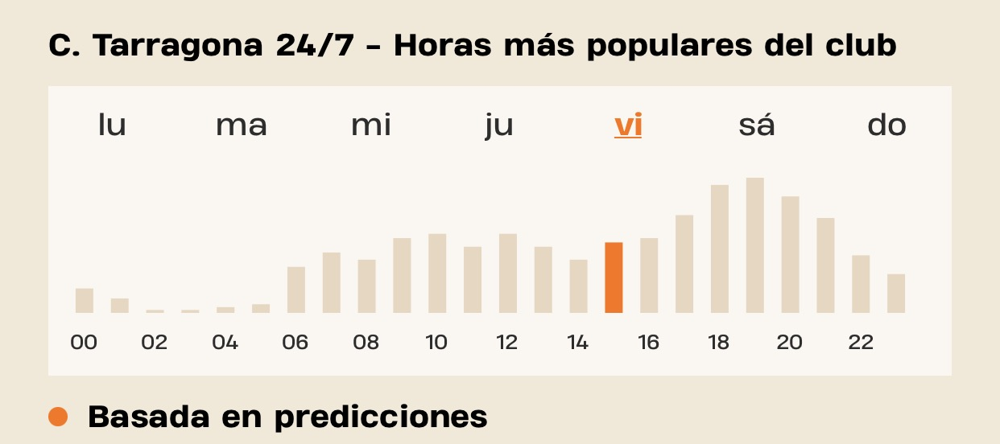
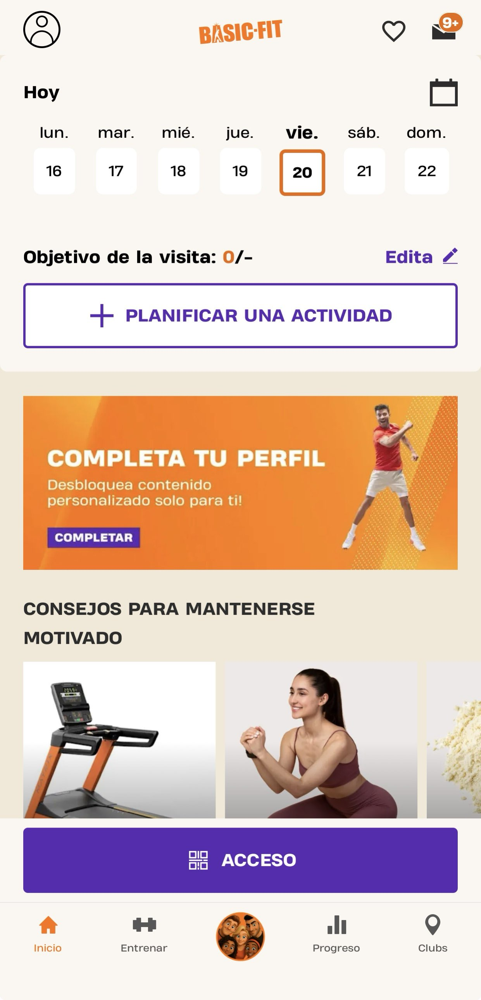
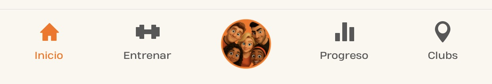

# Anàlisi d'una app real de gimnàs

**App analitzada:** Basic-Fit
**Plataforma:** iOS
**Club:** C. Tarragona 24/7
**Tasca provada:** consultar l'afluència del club, obrir el codi QR d'entrada i navegar per la pantalla d'inici

## Encerts

### Encert 1: gràfic d'hores més populars del club
- **Principi de Nielsen:** 1. Visibilitat de l'estat del sistema
- **Què fa bé:** l'app mostra un gràfic de barres amb l'afluència prevista per a cada hora del dia i marca en taronja l'hora actual i el dia d'avui. A més, indica clarament que les dades estan «basades en prediccions», de manera que l'usuari sap què està mirant i pot triar l'hora amb menys gent.
- **Captura:** 

### Encert 2: entrada al club amb un sol botó
- **Principi de Nielsen:** 7. Flexibilitat i eficiència d'ús
- **Què fa bé:** a la pantalla d'inici hi ha un botó morat gran, «ACCESO», amb la icona del QR, fixat just a sobre de la barra de navegació inferior. És l'acció més important de l'app i sempre és visible i a l'abast del polze, fins i tot fent servir el mòbil amb una sola mà. L'usuari habitual entra al club en segons, sense navegar per menús ni portar la targeta física.
- **Captura:** 

## Problemes

### Problema 1: el codi QR depèn de la connexió i no s'explica què fer si falla
- **Principi de Nielsen incomplert:** 9. Ajudar a reconèixer, diagnosticar i recuperar-se dels errors
- **Què passa:** el codi QR es renova contínuament i la pantalla està protegida: si en fas una captura, surt completament negra. Això té sentit per seguretat, però vol dir que l'usuari depèn de tenir connexió a l'entrada del gimnàs. Si no hi ha cobertura i el codi no carrega, l'app no explica el motiu ni ofereix cap alternativa.
- **Proposta de millora:** mostrar un missatge clar («Sense connexió: no es pot generar el codi») amb una solució, com ara un codi de recanvi vàlid uns minuts o les instruccions per demanar ajuda a recepció.
- **Captura:**  *(la captura surt negra perquè l'app bloqueja les captures de la pantalla del QR)*

### Problema 2: una icona sense etiqueta a la barra de navegació
- **Principi de Nielsen incomplert:** 4. Consistència i estàndards
- **Què passa:** la barra inferior té cinc botons. Quatre porten icona i text («Inicio», «Entrenar», «Progreso», «Clubs»), però el del mig només mostra una il·lustració d'un grup de persones, sense cap text. Trenca el patró de la resta de botons i l'usuari no pot saber què fa fins que el prem (també incompleix el principi 6, reconèixer abans que recordar). Per a un usuari amb lector de pantalla, un botó sense text és encara més difícil d'entendre.
- **Proposta de millora:** afegir-hi una etiqueta curta com la resta de botons (per exemple, «Comunitat») i un text alternatiu per als lectors de pantalla.
- **Captura:** 

## Què aprenem per a GymFlow
- **Copiarem:** mostrar l'estat en temps real (places lliures d'una classe) destacant el que és rellevant ara mateix, i una acció principal sempre visible a l'inici (la propera reserva).
- **Evitarem:** errors sense explicació. Si una acció no es pot fer (classe plena, sense connexió), GymFlow dirà el motiu i oferirà una alternativa, com «És plena. Vols la llista d'espera?».
- **Mantindrem:** totes les icones de la barra de navegació amb el seu text, perquè l'usuari reconegui cada opció sense haver de provar-la.
